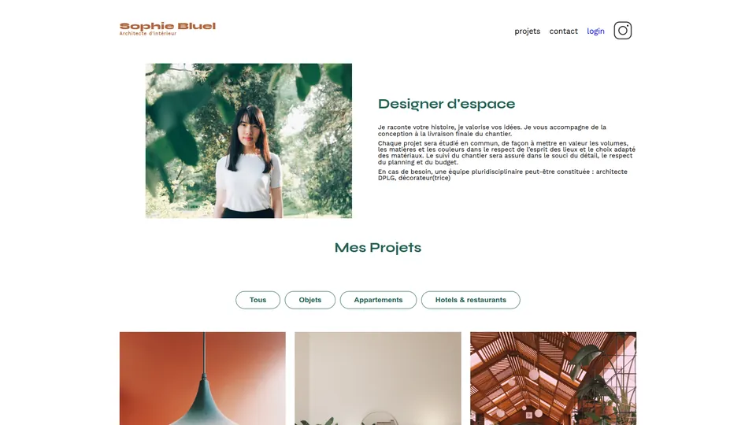

# Sophie Bluel : portfolio d'architecte d'intérieur

Projet 6 du parcours Développeur web d'OpenClassrooms : rendre dynamique, en JavaScript, le
portfolio d'une architecte d'intérieur, à partir d'une API fournie.

## Fonctionnalités

- Galerie des projets chargée depuis l'API, avec des filtres par catégorie.
- Page de connexion : le jeton renvoyé par l'API est gardé dans le navigateur
  (`localStorage`) et supprimé à la déconnexion.
- Mode édition, une fois connecté : une fenêtre modale permet de supprimer des projets et
  d'en ajouter (aperçu de la photo, vérification du formulaire avant l'envoi).

## Stack

- Front : HTML, CSS, JavaScript (sans framework).
- API fournie : Node.js, Express, SQLite, documentée avec Swagger.

## Lancer en local

1. Back-end : dans le dossier `Backend`, lancer `npm install` puis `npm start`. L'API répond
   sur http://localhost:5678 (documentation sur http://localhost:5678/api-docs).
2. Front-end : ouvrir `FrontEnd/index.html` avec l'extension Live Server de VS Code.

Compte de test : `sophie.bluel@test.tld` / `S0phie`.

---

Projet présenté dans mon portfolio : https://nicolas-grasser.vercel.app
